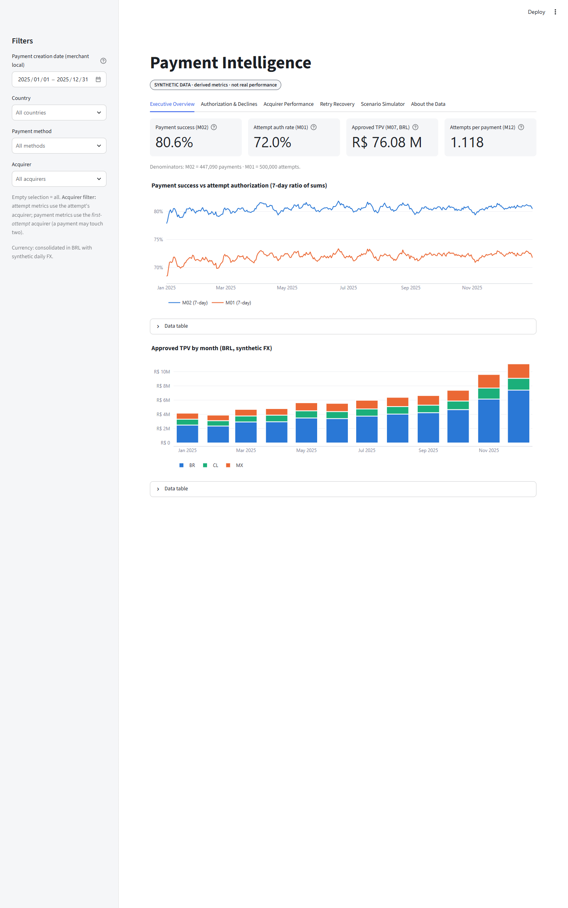

# 01 · Payment Intelligence & Transaction Optimization

> **Synthetic data only.** The PSP, merchants, acquirers, FX rates and fees are fictitious and generated with a fixed seed. Patterns in the data were planted by the generator, so the project demonstrates method, not market facts. Take rate and revenue rely on a synthetic MDR and are marked **[TO VERIFY]**.

**Executive question:** where do payment attempts fail, why, and which changes could raise approval without hurting cost, risk and experience?



## What is inside
| Layer | What it does | Where |
|---|---|---|
| Design | Personas, business questions, data contracts, metric catalog M01–M14 (grain, numerator, denominator) | [`docs/`](docs/) |
| Generator | Deterministic PSP simulator: 3 countries/currencies, cards + Pix, up to 3 attempts per payment, latent risk, Parquet + manifest with SHA-256 | `src/fintech_lab/p1_payments/generator.py`, [`configs/generator.yaml`](configs/generator.yaml) |
| Data-quality fixture | Separate corrupted dataset with 14 injected defects, each caught by a check | `corrupt.py`, `tests/p1/test_quality_checks.py` |
| SQL | DuckDB staging → core → 5 marts, 13 contract + 5 reconciliation checks, 15 analyses, EXPLAIN ANALYZE plans | [`sql/`](sql/), [`docs/sql_walkthrough.md`](docs/sql_walkthrough.md) |
| Diagnosis & scenarios | Failure taxonomy, mix-adjusted acquirer ranking, S1 rerouting and S2 retry-cap simulations with intervals and sensitivity grids | [`reports/diagnostic_memo.md`](reports/diagnostic_memo.md) |
| Dashboard | Streamlit, 6 tabs, filters that keep denominators correct, provenance and synthetic labels | [`app/app.py`](app/app.py), [`docs/dashboard_qa.md`](docs/dashboard_qa.md) |
| Audit | Independent review with severity-ranked findings and the fixes applied | [`reports/audit_report.md`](reports/audit_report.md) |

## Run it (Windows, from the repo root)
```powershell
py -3.12 -m venv .venv
.\.venv\Scripts\Activate.ps1
python -m pip install -r requirements-lock.txt
python -m pip install -e . --no-deps
python -m fintech_lab.p1_payments.cli dashboard     # generates + builds if missing, opens :8501
```
Step by step:
```powershell
python -m fintech_lab.p1_payments.cli generate      # 500k attempts (--attempts 2000000 to scale)
python -m fintech_lab.p1_payments.cli build         # aborts (exit 1) if any contract/reconciliation check fails
python -m fintech_lab.p1_payments.cli check         # prints PASS/FAIL per check
python -m fintech_lab.p1_payments.cli diagnose      # rewrites reports/diagnostic_memo.md + CSVs
pytest -q tests/p1
```
The same seed gives the same `dataset_content_sha256` in the same environment. The manifest records the library versions, and `requirements-lock.txt` pins them.

## Key decisions
- **TPV counts payments, not attempts.** Attempts are aggregated per `payment_id` before any join, and reconciliation checks prove that retries do not inflate TPV.
- **No unqualified "approval rate".** M01 is per attempt and M02 per payment; every KPI states its grain and denominator, including under dashboard filters.
- **Currencies are never summed raw.** BRL consolidation uses the synthetic FX of the payment's local creation date.
- **Scenarios are simulations, not uplift.** S1 uses a θ-mixture (θ = 0 is the null). S2 cap 4 is labelled as extrapolation. Intervals cover sampling noise only, and the memo states only the signs that its intervals support.
- Full log: [`docs/decisions.md`](../../docs/decisions.md).

## Limitations
- Circularity: the generator planted every effect found here (for example acquirer gaps and peak-hour errors).
- S1 is close to unbiased only because the generator randomizes acquirer switching. Real routing is risk-dependent, so the same comparison would be confounded, and a randomized test is needed (Project 03).
- The generator models no merchant churn, so cohort retention is about 1 by construction (SQL demo only).
- Keyboard and screen-reader accessibility have not been audited **[TO VERIFY]**. No dark theme.
- CI is configured (`.github/workflows/ci.yml`) but has not run yet, because the repository has no remote **[TO VERIFY]**.
