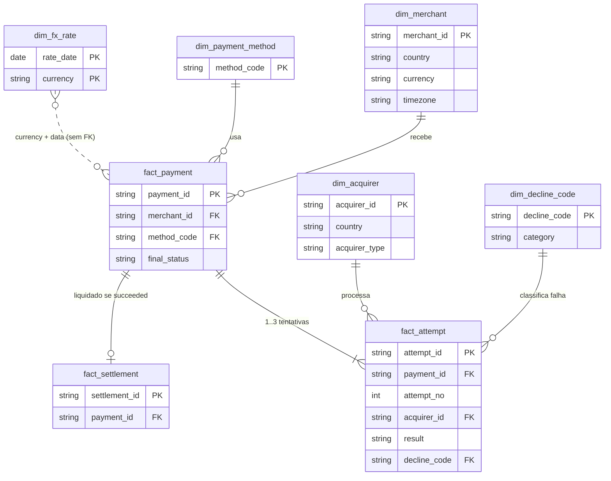

# P1 · Data dictionary

Proveniência por tabela: todas as tabelas brutas são `synthetic`; colunas calculadas em marts são `derived`.
Timestamps em **UTC** (`*_utc`); o fuso local vem de `dim_merchant.timezone`. Valores monetários ficam na **moeda original**.

## ERD


## Ciclo de vida e estados
```
payment criado ─► attempt 1 ─┬─ approved ─────────────► final_status = succeeded ─► settlement (D+N)
                             ├─ declined (hard) ───────► final_status = failed (sem retry)
                             └─ declined (soft) | error ► attempt n+1 (se n < 3 e retry sorteado)
                                                          └─ sem nova tentativa ─► final_status = failed
```
- `result` ∈ {`approved`, `declined`, `error`}. `error` = falha técnica (timeout, erro do adquirente), não é recusa do emissor.
- No máximo **1** tentativa `approved` por pagamento, e ela é sempre a **última**.
- Retry só depois de `declined` com `category = soft` ou de `error`. Após `hard`, não há retry.
- O retry pode ir para o mesmo adquirente ou para outro **do mesmo país e tipo**.

## Tabelas

### `dim_merchant` · grão: 1 merchant
| Coluna | Tipo | Domínio / regra |
|---|---|---|
| merchant_id | string PK | `M00001`… |
| sector | string | `ecommerce_retail`, `digital_goods`, `travel`, `food_delivery`, `subscriptions` |
| country | string | `BR`, `MX`, `CL` |
| currency | string | BR→`BRL`, MX→`MXN`, CL→`CLP` (1:1 com país) |
| timezone | string | `America/Sao_Paulo`, `America/Mexico_City`, `America/Santiago` |
| size_tier | string | `small`, `mid`, `large` |
| activation_date | date | ≤ data do primeiro pagamento do merchant |

### `dim_acquirer` · grão: 1 adquirente/provider (cada um atua em 1 país)
| Coluna | Tipo | Domínio / regra |
|---|---|---|
| acquirer_id | string PK | `ACQ_BR_A`, `ACQ_BR_B`, `PIX_BR`, `ACQ_MX_A`, `ACQ_MX_B`, `ACQ_CL_A`, `ACQ_CL_B` |
| country | string | `BR`, `MX`, `CL` |
| acquirer_type | string | `card_acquirer`, `pix_provider` |
| fee_fixed_local | decimal | custo fixo por tentativa, moeda local (parâmetro sintético) |
| fee_bps_approved | int | custo variável em bps sobre o valor de tentativas aprovadas |

### `dim_payment_method` · grão: 1 método
| Coluna | Tipo | Domínio / regra |
|---|---|---|
| method_code | string PK | `credit_card`, `debit_card`, `pix` |
| method_family | string | `card`, `instant_transfer` |
| available_countries | string | cartões: BR, MX, CL; pix: BR |
| settlement_lag_days | int | crédito 2, débito 1, pix 0 (parâmetros sintéticos) |

### `dim_decline_code` · grão: 1 código de falha
| decline_code | category | reason_group | retryable |
|---|---|---|---|
| `insufficient_funds` | soft | funds | sim |
| `limit_exceeded` | soft | funds | sim |
| `do_not_honor` | soft | issuer_generic | sim |
| `issuer_unavailable` | soft | issuer_technical | sim |
| `suspected_fraud` | hard | risk | não |
| `invalid_card` | hard | card_data | não |
| `expired_card` | hard | card_data | não |
| `pix_rejected` | hard | pix | não |
| `timeout` | technical | technical | sim |
| `acquirer_error` | technical | technical | sim |

Regras: `result = declined` ⇒ `category ∈ {soft, hard}`; `result = error` ⇒ `category = technical`; `approved` ⇒ `decline_code` nulo.

### `dim_fx_rate` · grão: 1 moeda × 1 dia
| Coluna | Tipo | Domínio / regra |
|---|---|---|
| rate_date | date PK | cobre todo o período dos pagamentos |
| currency | string PK | `BRL` (=1.0), `MXN`, `CLP` |
| rate_to_brl | decimal(18,8) | > 0; série sintética (passeio aleatório com seed) |

### `fact_payment` · grão: 1 pagamento iniciado
| Coluna | Tipo | Domínio / regra |
|---|---|---|
| payment_id | string PK | único |
| merchant_id | string FK | existe em `dim_merchant` |
| method_code | string FK | disponível no país do merchant |
| created_at_utc | timestamp | ≤ `attempted_at_utc` da 1ª tentativa |
| amount | decimal | > 0; CLP sem casas decimais, BRL/MXN com 2 |
| currency | string | = `dim_merchant.currency` |
| device_type | string | `web`, `mobile_app` |
| final_status | string | `succeeded` se existe tentativa aprovada, senão `failed` |

### `fact_attempt` · grão: 1 tentativa de autorização
| Coluna | Tipo | Domínio / regra |
|---|---|---|
| attempt_id | string PK | único |
| payment_id | string FK | existe em `fact_payment` |
| attempt_no | int | 1..3, sequencial sem lacunas por pagamento; (`payment_id`, `attempt_no`) único |
| acquirer_id | string FK | mesmo país do merchant; `pix_provider` ⇔ `method_code = pix` |
| attempted_at_utc | timestamp | estritamente crescente com `attempt_no` |
| result | string | `approved`, `declined`, `error` |
| decline_code | string FK nulo | regras de `dim_decline_code` |
| latency_ms | int | > 0 |
| processing_cost | decimal | moeda do pagamento; `fee_fixed_local` + bps se aprovada |

### `fact_settlement` · grão: 1 evento de liquidação (1 por pagamento `succeeded`)
| Coluna | Tipo | Domínio / regra |
|---|---|---|
| settlement_id | string PK | único |
| payment_id | string FK | único; só pagamentos `succeeded` |
| settlement_date | date | data local da aprovação + `settlement_lag_days` |
| gross_amount | decimal | = `fact_payment.amount` |
| fee | decimal | MDR cobrado do merchant (taxa sintética por método × porte) |
| net_amount | decimal | = `gross_amount − fee` |
| currency | string | = `fact_payment.currency` |
